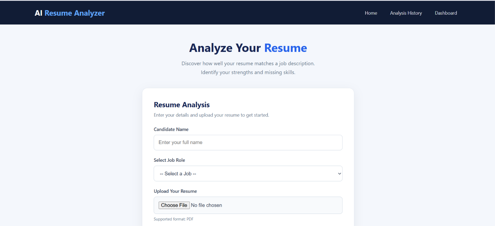

# AI Resume Analyzer and Job Matcher

A Django-based web application that analyzes PDF resumes against selected job descriptions using **Python, MySQL, TF-IDF, and Cosine Similarity**.

The application extracts resume text, identifies matched and missing skills, calculates matching scores, and stores analysis results for future reference.

## Project Overview

Recruiters and job seekers often need to compare resumes with job requirements. This project simplifies that process by providing an application that analyzes resumes and displays matching results.

### Key Features

- Upload resumes in PDF format.
- Select job descriptions from available jobs.
- Extract text from PDF resumes.
- Compare resume skills with required job skills.
- Calculate text similarity using TF-IDF and Cosine Similarity.
- Display matched and missing skills.
- Save analysis results in MySQL.
- View previous analyses through an Analysis History page.
- Monitor results through a Dashboard.

## Technologies Used

| Technology | Purpose |
|---|---|
| Python | Application logic |
| Django | Web framework |
| HTML5 | Page structure |
| CSS3 | User interface and styling |
| MySQL | Store job descriptions and analysis results |
| mysql-connector-python | Python–MySQL connectivity |
| pypdf | Extract text from PDF resumes |
| scikit-learn | TF-IDF and Cosine Similarity |

**Database note:** The project-specific tables are accessed using MySQL Connector. Django's internal tables may use SQLite in the current development setup.

## Application Pages

### 1. Home Page

- Enter candidate details.
- Select a job description.
- Upload a PDF resume.
- View skill matching and text similarity results.

### 2. Analysis History
- View previously analyzed resumes.
- Check candidate names and job titles.
- Review matching scores and missing skills.

### 3. Dashboard
- View total resumes analyzed.
- View available job descriptions.
- Monitor average match score.
- View highest match score.
- Review recent analyses.

## How the Application Works

The application follows these steps:

1. The user enters the candidate name.
2. The user selects a job description.
3. The user uploads a PDF resume.
4. The application extracts resume text using `pypdf`.
5. Required skills are compared with the extracted resume text.
6. Matched and missing skills are identified.
7. TF-IDF converts the resume and job description text into numerical vectors.
8. Cosine Similarity calculates the text similarity score.
9. The analysis results are saved in MySQL.
10. The user can view results in the application and analysis history.

## Matching Methodology

### 1. Skill Matching

The application compares the required skills from the selected job with the extracted resume text.

The skill match percentage is calculated using:

**Skill Match Score = (Matched Skills / Total Required Skills) × 100**

The application displays:
- Matched skills
- Missing skills
- Skill match percentage

### 2. Text Similarity Using TF-IDF

TF-IDF stands for Term Frequency–Inverse Document Frequency.

It converts text into numerical representations based on the importance of words in the documents.

### 3. Cosine Similarity

Cosine Similarity measures the similarity between two numerical vectors.

The application uses it to calculate a text similarity percentage between the resume and job description.

**Note:** Skill matching currently uses text-based matching. It may not recognize synonyms, understand context, or evaluate proficiency. Similarity and skill scores are indicators, not hiring decisions.

## Database Design

**Database Name:** `ai_resume_matcher`

### Table 1: `job_descriptions`

Stores available job descriptions.

| Column | Description |
|---|---|
| job_id | Job identifier |
| job_title | Job title |
| company_name | Company name |
| description | Job description |
| required_skills | Skills required for the job |

### Table 2: `resume_analyses`

Stores resume analysis results.

| Column | Description |
|---|---|
| analysis_id | Analysis identifier |
| candidate_name | Candidate name |
| job_id | Related job identifier |
| resume_filename | Uploaded resume filename |
| match_score | Skill match percentage |
| matched_skills | Skills found in the resume |
| missing_skills | Skills missing from the resume |
| created_at | Analysis date and time |
| similarity_score | Text similarity percentage |

The Analysis History page uses a SQL JOIN on `job_id` to retrieve the corresponding job title.

## Project Structure

```text
ai_resume_matcher/
│
├── config/
│   ├── __init__.py
│   ├── settings.py
│   ├── urls.py
│   ├── asgi.py
│   └── wsgi.py
│
├── resume_analyzer/
│   ├── migrations/
│   ├── templates/
│   │   └── resume_analyzer/
│   │       ├── home.html
│   │       ├── history.html
│   │       └── dashboard.html
│   ├── __init__.py
│   ├── admin.py
│   ├── apps.py
│   ├── models.py
│   ├── tests.py
│   └── views.py
│
├── analysis_history.py
├── main.py
├── manage.py
├── pdf_reader.py
├── similarity.py
├── README.md
└── .gitignore
```

## Installation and Setup

Follow these instructions to run the project locally on Windows.

### Step 1: Clone the Repository

```bash
git clone https://github.com/DSUMITHRA/ai-resume-analyzer-job-matcher.git
```

Navigate into the project folder:

```bash
cd ai-resume-analyzer-job-matcher
```

### Step 2: Install Dependencies

```bash
python -m pip install django mysql-connector-python pypdf scikit-learn
```

### Step 3: Configure Environment Variables

In PowerShell, set the MySQL password:

```powershell
$env:MYSQL_PASSWORD = "YOUR_MYSQL_PASSWORD"
```

Generate a Django secret key for the current terminal session:

```powershell
$env:DJANGO_SECRET_KEY = python -c "from django.core.management.utils import get_random_secret_key; print(get_random_secret_key())"
```

Do not store actual passwords or secret keys in source code or GitHub.

These environment variables need to be configured again when opening a new terminal.

### Step 4: Configure MySQL

1. Open MySQL Workbench.
2. Create the database:

```sql
CREATE DATABASE ai_resume_matcher;
```

3. Create the `job_descriptions` and `resume_analyses` tables using the project database schema.
4. Insert job descriptions into the `job_descriptions` table.

The application requires job records to be available before resume analysis.

### Step 5: Check the Django Project

```bash
python manage.py check
```

### Step 6: Start the Development Server

```bash
python manage.py runserver
```

Open the application in your browser:

- **Home:** http://127.0.0.1:8000/
- **Analysis History:** http://127.0.0.1:8000/history/
- **Dashboard:** http://127.0.0.1:8000/dashboard/

Stop the server using `Ctrl + C`.

## Future Enhancements

- Improve skill matching using synonyms and contextual understanding.
- Implement advanced NLP-based resume analysis.
- Support DOCX and additional resume formats.
- Add user authentication and role-based access.
- Add charts, filters, and advanced dashboard analytics.
- Improve automated testing.
- Deploy the application to a cloud platform.

## Learning Outcomes

Through this project, I gained practical experience in:

- Python application development.
- Django web application development.
- MySQL database connectivity.
- SQL queries and JOIN operations.
- PDF text extraction.
- Text preprocessing and skill matching.
- TF-IDF vectorization.
- Cosine Similarity.
- Building a complete application with frontend, backend, and database integration.

## Important Notes

- This is an educational project.
- The application is intended for local development using Django's development server.
- The matching scores should not be treated as the sole basis for recruitment decisions.
- Never upload personal resumes, passwords, secret keys, or confidential information to GitHub.

## Author

**Sumithra**

GitHub: https://github.com/DSUMITHRA

---

If you find this project useful, feel free to explore the repository and its implementation.
